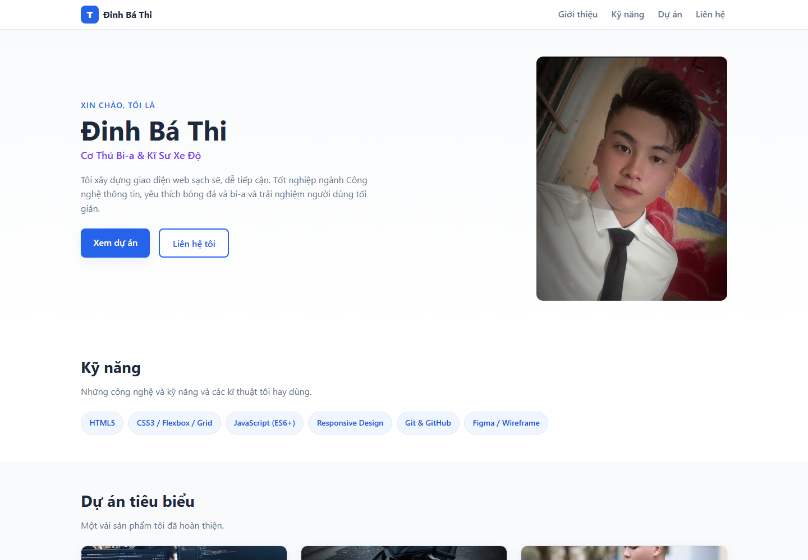
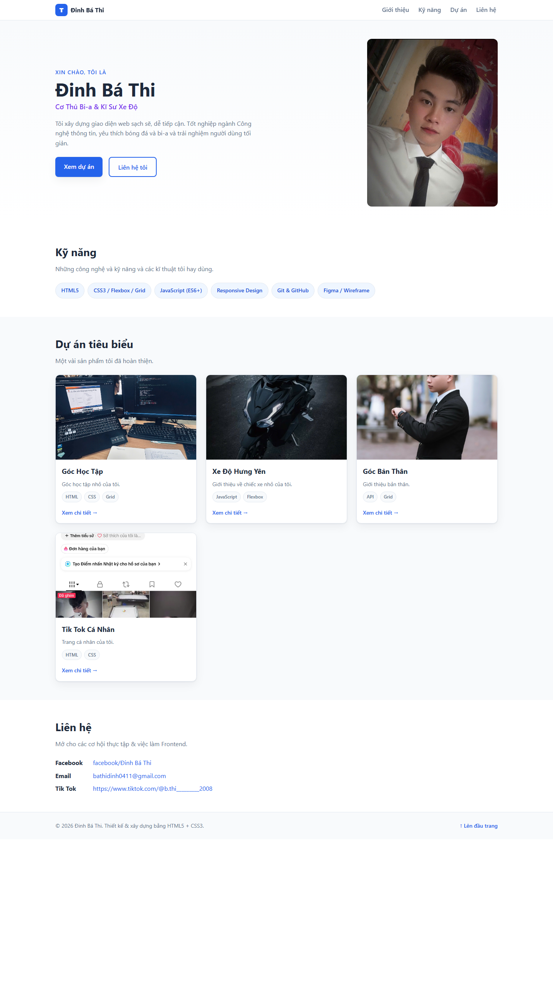

# Báo cáo kiểm thử

**Ngày kiểm thử:** 2026-10-27  
**Môi trường:** Google Chrome trên Windows, mở website từ `file://`  
**Phạm vi:** Kiểm tra giao diện ở các chiều rộng 390 px, 768 px và 1440 px; điều hướng, nội dung, ảnh và cấu trúc mã nguồn.

## Kết quả theo tiêu chí

| Tiêu chí | Kết quả | Minh chứng và nhận xét |
|---|---|---|
| **Tính đúng đắn** | Đạt cơ bản | Trang mở được; bốn liên kết điều hướng đến đúng mục Giới thiệu, Kỹ năng, Dự án và Liên hệ. Hiển thị đủ bốn thẻ dự án; cả năm ảnh trên trang tải thành công. Ba liên kết “Xem chi tiết” của dự án vẫn trỏ tới `#`, chưa mở nội dung dự án. |
| **UI/UX** | Đạt cơ bản | Đã kiểm tra bố cục ở 390 px, 768 px và 1440 px. Lưới dự án lần lượt hiển thị một, hai và ba cột; không phát hiện tràn chiều rộng trang trong các lần kiểm tra này. Ảnh chụp desktop bên dưới ghi lại giao diện và các mục nội dung. Chưa thực hiện đánh giá khả năng tiếp cận chuyên sâu. |
| **Khả năng vận hành - xử lý lỗi** | Đạt một phần | Website tĩnh mở được trực tiếp trong trình duyệt và không cần bước cài đặt hay biên dịch. Không có JavaScript, biểu mẫu hoặc backend cần kiểm thử luồng lỗi; trang chưa có cơ chế dự phòng khi thiếu tệp ảnh/CSS. Chưa kiểm thử lỗi phát sinh từ máy chủ web. |
| **Bảo mật** | Đạt một phần | Trong phạm vi mã nguồn đã xem, trang chỉ gồm HTML/CSS tĩnh, không có xử lý đầu vào, đăng nhập, backend, thư viện bên thứ ba hay thông tin bí mật. Chưa quét bảo mật tự động và chưa đánh giá các header bảo mật khi triển khai trên máy chủ. |
| **Chất lượng mã nguồn** | Đạt một phần | HTML có các vùng ngữ nghĩa như `header`, `nav`, `main`, `section`, `article`, `footer`; CSS được tách riêng, dùng biến giao diện và media query. Còn ba liên kết dự án giữ chỗ (`href="#"`) và liên kết email chưa dùng `mailto:`; chưa chạy công cụ lint hoặc kiểm định HTML/CSS. |
| **Khả năng triển khai** | Đạt một phần | Website và các tài nguyên cục bộ hoạt động khi mở trực tiếp; dự án không có phụ thuộc build. Chưa triển khai hoặc chạy thử qua HTTP/Nginx/Docker, nên chưa xác nhận cấu hình máy chủ, HTTPS hay header khi phát hành. |

## Ảnh minh chứng

Ảnh được chụp từ website trong quá trình kiểm thử và lưu trong thư mục `docs/screenshots/`.

### Giao diện desktop

### Toàn trang desktop

## Phạm vi và giới hạn

- Đây là kiểm thử thủ công trên bản cục bộ; không thay thế kiểm thử trên nhiều trình duyệt hoặc thiết bị thật.
- Không kiểm tra khả năng truy cập thực tế của các liên kết mạng xã hội và không thực hiện kiểm thử tải hay quét lỗ hổng tự động.
- Các liên kết dự án và email nêu trên cần được cập nhật trước khi phát hành chính thức.